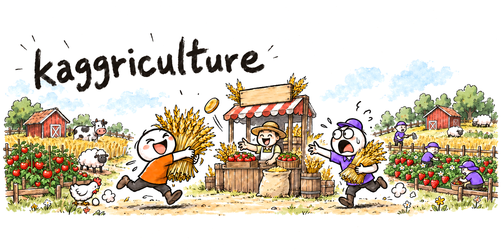
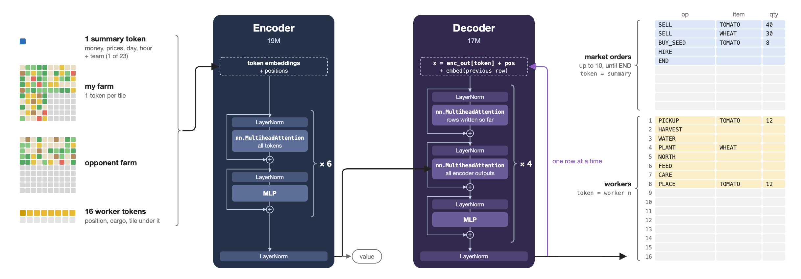

[](https://www.kaggle.com/competitions/kaggriculture/writeups/trading-clutch-no-b200)

# Kaggriculture 2nd / 10148 - Neural Network full recipe

- Trains a Kaggriculture player from game replays in three stages:
  - Supervised training on the games of the top 20 of the Kaggle leaderboard.
  - Fine-tuning on one of those teams.
  - PPO against frozen copies of the fine-tuned player.
- The solution is explained in the [Kaggle write-up](https://www.kaggle.com/competitions/kaggriculture/writeups/trading-clutch-no-b200).
- The repository holds code only: no replays, checkpoints or match evaluation of the trained player.

## Model

**HourFormer** (*model.py*, 37.2M parameters) reads one hour's observation and writes that hour's whole action.
Download the weights from [Kaggle Models](https://www.kaggle.com/models/vmerckle/kaggriculture-2nd-place).



- **Input**, 217 tokens:
  - 1 global token: 157 values through an MLP, plus a team embedding when conditioned.
  - 200 tile tokens: 2 boards × 100 tiles × 24 byte features, with tile-position and board embeddings.
  - 16 unit tokens: 31 byte features each, with slot embeddings.
- **Encoder**: 6 pre-norm transformer layers, d_model 512, 8 heads, FFN 2048, GELU.
- **Decoder**: 4 causal layers over 26 action rows, 10 market rows then 16 unit rows.
  Each row is an (operation, item, quantity) triple, decoded autoregressively, with quantities 0 to 100.
- **Operations**:
  - 8 market: `END`, `NOOP`, `BUY_SEED`, `BUY_PRODUCT`, `BUY_ANIMAL`, `SELL`, `HIRE`, `BUY_LAND`.
  - 18 unit: `PASS`, 4 moves, `PLANT`, `WATER`, `HARVEST`, `FERTILIZE`, `DIG`, `BUILD_COOP`, `BUILD_PASTURE`, `PICKUP`, `PLACE`, `DROP`, `FEED`, `CARE`, `COLLECT_FERTILIZER`.
  - The item and quantity heads are masked to the operations that need them.
- **Value head** on the global token, used by PPO.
- **Team conditioning**: a team embedding added to the global token.
  `python bc.py export` folds one team's embedding into a bias, which gives a plain single-team player.

## Requirements

- Python 3.12 and `pip install -r requirements.txt`, tested with torch 2.14.0 on CUDA 13 and numpy 2.5.1.
- The game engine comes from kaggle-environments, pinned to 1.32.7, the engine version the replays must come from.
- Linux, since training needs CUDA (and NCCL for multi-GPU runs).
- One CUDA GPU with 32 GB or more; PPO reserves up to 23.5 GiB.
- About 5 MB of SSD per selected seat, since the corpus is memory-mapped and read at random.
- 12 or more CPU cores for PPO rollouts.
- Replay inputs prepared as described in [*DATA.md*](DATA.md); no replays or episode index are distributed.

## Training

```bash
python corpus.py /path/to/local/replay-input out/corpus
bash train.sh out      # 1 GPU
bash train.sh out 8    # 8 GPUs
```

Estimated time: about 28h on one RTX 5090, or 5.5h on 8.
Below, *OUT* stands for the output folder (`out` above).

### Corpus

*corpus.py* replays every seat of the selected teams on the kaggle-environments 1.32.7 engine and skips seats that do not reproduce their recorded rewards.

- It holds out 5% of each team's games by a seeded shuffle and keeps the first 30 held-out seats per team in *OUT/corpus/val*.
- *OUT/corpus/train* holds the hours as one memory-mapped *.npy* file per field: 5.8 KB per hour, or 4.2 MB per seat of 719 hours.
- *rows.npy* lists the training rows; won training seats from the 24h before the index's newest game are listed 4 times.
- *finetune.npy* lists the rows of the fine-tune team's two newest submissions.

### Stages

*train.sh* runs five stages and writes *OUT/player.pt*; times are for one RTX 5090.

1. **bc** → *OUT/bc*, about 25h (0.8s per step).
   114K steps of 1,792 rows, AdamW lr 1e-3, 300 warmup steps, cosine to 1e-4, weight decay 0.1, dropout 0.1, team hidden in 10% of rows, validation every 1K steps.
2. **finetune** → *OUT/finetune*, about 1min.
   600 steps on *finetune.npy*, lr 5e-5, 50 warmup steps, cosine, team always shown.
3. **players** → *OUT/players/finetuned_step400.pt* and *OUT/players/finetuned_step600.pt*, seconds.
   The fine-tune team's player, exported from fine-tune steps 400 and 600.
4. **ppo** → *OUT/ppo*, about 2h10min (8.5min per iteration with 12 workers).
   Starts from *finetuned_step600* against 7 frozen opponents: *finetuned_step400* ×3 and *finetuned_step600* ×4, with and without the `A1` rules.
   15 iterations of 688 games at temperature 0.5.
   Each iteration takes 22 optimizer steps of 44 × 512 rows, lr 2e-5, 20 warmup steps, GAE lambda 1, target KL 0.05, and 25% of its games replay earlier losses.
5. **player** → *OUT/player.pt*, seconds.
   Final PPO weights, architecture config and iteration number, without optimizer state.

### Resuming and options

- *corpus.py* and *train.sh* resume when rerun: finished stages are skipped and interrupted stages continue from their last checkpoint.
- `TIME_LIMIT=MINUTES bash train.sh OUT [GPUS]` exits with code 75 before the limit; rerun the same command to continue.
- `UNTIL=players` stops after the player export.
- `PPO_ITERATIONS`, `PPO_GAMES`, `PPO_ACCUM` and `PPO_WORKERS` override the PPO defaults (15, 688, 44, 12).
- `BC_BATCH` and `BC_ACCUM` override the clone split; `PY` sets the Python interpreter.
- The GPU count (1, 2, 4, 7 or 8) only splits the clone stages: 1 GPU runs 7 minibatches of 256 per step, 8 GPUs run 224 rows each, and every count keeps 1,792 rows per step.
- PPO always runs on one GPU and keeps the network in eval mode, so dropout is off in its rollouts and updates.

### Progress

- *OUT/train.txt*: one line per finished stage.
- *OUT/bc/metrics.jsonl*, *OUT/finetune/metrics.jsonl* and *OUT/ppo/metrics.jsonl*: one line per log step or iteration.
- *OUT/\*/train.log*: full output of each stage.
- `val_nll` is the held-out negative log-likelihood per hour with the team input, `val_nll_pooled` without it.
- PPO's `win_rate` is the learner's win rate against the frozen opponents in that iteration.

## Inference

```bash
python agent.py out/player.pt --device cuda
```

- *agent.py* reads one JSON observation per line (or an object with `obs` and an optional `config`) and writes one action object per line.
- `{"cmd": "ping"}` and `{"cmd": "exit"}` are supported, and `--device cpu` runs on CPU.
- *OUT/player.pt* is a checkpoint, not a packaged Kaggle submission.
- Checkpoints are loaded with pickle, so load only trusted ones.

### Action rules

*agent.py* edits the network's action with rule presets from *rules.py*, `D1+A1+W1` by default (`--rules` changes it):

- `D1` (deliver): from step 690, workers carrying cargo walk back to the shed in time to drop it before the game ends.
- `A1` (recovery and melons): keeps drops from overflowing the shed, sells each day's overflow at the last hour while keeping 30 wheat, and sells everything on the final step.
  On day 18 (counting from 0) it buys melon seeds and switches planting to melons when their estimated revenue, after the seed cost, beats the displaced crop by 100 or more.
- `W1` (wheat trading): every 4 hours from step 288, it buys up to 100 wheat when money is above 6,000 and the shed has room, then sells it the next hour.
  While the wheat is held, the network sees adjusted wheat stock, prices and money, while the other rules see the real observation.

`W1` runs after the other rules, and all rules reset at each new game.
A rule that raises is reported on stderr once per process, and that hour's network action is kept unchanged.
During PPO the learner plays without rules, and only some opponents use `A1`.

## Files

- *corpus.py*: builds the packed corpus from a replay folder.
- *train.sh*: runs all stages, resumable.
- *bc.py*: behavior cloning, team-player export, metrics and checkpoint helpers.
- *ppo.py*: PPO against frozen players.
- *model.py*: the network.
- *features.py*: tile, unit and global observation encoding.
- *actions.py*: action encoding as 26 rows of (operation, item, quantity).
- *game.py*: one game on the kaggle-environments engine, stepped hour by hour.
- *workers.py*: checkpoint loading, inference, parallel engine processes, rollouts.
- *agent.py*: JSON-line inference with the action rules.
- *rules.py*: action rules and the `W1` observation adjustments.
- [*DATA.md*](DATA.md): replay input format and dataset selection.
- *requirements.txt*: Python packages.

## License

MIT, see [*LICENSE*](LICENSE).
